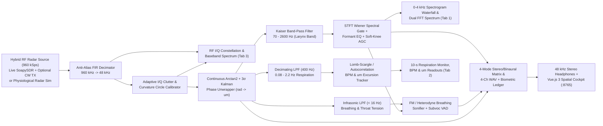

# GNU-Larex — RF Micro-Doppler Vibrometry, Subvocalization, Respiration & NightSweep Signal-Intelligence Suite

**GNU-Larex** is a complete GNU Radio 3.10+ (`radioconda`) signal-processing flowgraph, dark-mode Qt telemetry application, and embedded **Vue.js 3 + Three.js 3D Spatial & Signal-Intelligence Web Cockpit (`:8765`)** designed to sense, isolate, visualize, sonify, and audit **human breathing**, **infrasonic laryngeal tension**, **vocal-fold / silent-speech subvocalizations**, **wideband ultrasonic/RF reflections**, and **per-person biometric word ledgers** using **SDR RF micro-Doppler vibrometry** and **wideband acoustic/ultrasonic transducers** (with built-in physiological RF/acoustic digital twins for zero-hardware exploration).

---

## Signal Processing Architecture

When a continuous-wave (CW) RF carrier of wavelength $\lambda = c / f_{\text{RF}}$ illuminates the neck (thyroid cartilage / suprasternal notch) and upper chest, micrometer-to-millimeter skin displacements $x(t)$ phase-modulate the reflected quadrature $I/Q$ signal:

$$z(t) = C_{\text{leakage}} + A_{\text{skin}} \exp\!\left(j \left[\frac{4\pi}{\lambda} x(t) + \phi_0\right]\right) + n(t)$$

GNU-Larex recovers $x(t)$ down to the micrometer scale and splits it into three dedicated physiological bands while streaming real-time telemetry and word-level forensics to the embedded Vue.js 3 Web Cockpit:



---

## Quick Start & GitHub Clone Starter Guide

Because large runtime binaries, ML weights, Node packages, and personal recordings (`/radioconda/`, `/models/faster-whisper/`, `/models/speaker-onnx/`, `/web/node_modules/`, `/web/dist/`, and `/recordings/*`) are excluded via `.gitignore`, GNU-Larex includes an interactive **NightSweep Models, Modals & Full Dependency Starter Guide** directly in the Vue.js frontend (`NightSweepStarterGuidePanel.vue` + `/api/starter-guide/status` & `/api/starter-guide/bootstrap`).

### 1. Install Radioconda & Python DSP Dependencies
```powershell
.\scripts\setup_radioconda.ps1
.\radioconda\Scripts\pip.exe install faster-whisper onnxruntime cryptography flask requests sounddevice scipy pyzmq
```

### 2. Build the Local NightSweep Signal-Intelligence Ollama Model
The repository tracks `models/Modelfile.nightsweep-signalintelligence` containing the 16-module system specification. To enable live local LLM inference at `127.0.0.1:11434`:
```powershell
ollama pull llama3.1:8b
ollama create nightsweep-signalintelligence:latest -f models/Modelfile.nightsweep-signalintelligence
```
*(Or click **`⚡ Build Ollama NightSweep`** directly inside the frontend Starter Guide panel.)*

### 3. Cache Faster-Whisper ASR & WeSpeaker ResNet34-LM 256-D ONNX Weights
```powershell
# Cache Faster-Whisper small.en int8 CTranslate2 model into models/faster-whisper:
.\radioconda\python.exe -c "from faster_whisper import WhisperModel; WhisperModel('small.en', device='cpu', compute_type='int8', download_root='models/faster-whisper')"

# Download WeSpeaker VoxCeleb ResNet34-LM 256-D ONNX speaker model into models/speaker-onnx:
New-Item -ItemType Directory -Force -Path models\speaker-onnx
curl.exe -L -o models\speaker-onnx\voxceleb_resnet34_LM.onnx https://huggingface.co/csukuangfj/speaker-embedding-models/resolve/main/voxceleb_resnet34_LM.onnx
```

### 4. Build the Vue.js 3 + Three.js Frontend Cockpit
```powershell
cd web
npm install
npm run build
cd ..
```

### 5. Launch the Dark Telemetry Cockpit & Embedded Web UI (`http://127.0.0.1:8765`)
Double-click **`launch_gnu_larex.bat`** or run:
```powershell
# Start immediately in Physiological RF Radar Simulator mode (switchable live in GUI):
.\scripts\run_larex.ps1

# Start directly in Live SDR mode (auto-detects RTL-SDR, PlutoSDR, HackRF, USRP, etc.):
.\scripts\run_larex.ps1 --live --freq 915.0 --gain 35

# Full-Duplex SDRs (PlutoSDR, USRP B200/B210, LimeSDR, BladeRF) with CW TX Illuminator:
.\scripts\run_larex.ps1 --live --sdr-args "driver=plutosdr" --cw-tx --freq 2450.0 --gain 40

# Run the 19-test end-to-end verification suite:
.\radioconda\python.exe scripts\test_all_features.py
```

---

## NightSweep 16-Module Signal-Intelligence & Interactive Modal Suite

The embedded web cockpit (`src/larex_web_backend.py` + `web/src/`) and person/device dossier modals (`PersonEarwormModal.vue`) implement 16 integrated signal-intelligence modules across 8 tracked room and boundary identities (`PERSON_DELTA`, `PERSON_ALPHA`, `PERSON_BETA`, `PERSON_GAMMA`, `PERSON_TYPIST`, `DEVICE_CELLPHONE`, `DEVICE_MEMS`, `OTHER_ROOM_SUBLEVEL`):

1. **Cardio-Vocal BCG & Carotid PWTT Stress Index**: Isolates `0.8–3.2 Hz` ballistic dicrotic-notch micro-displacements and heart-rate variability (RMSSD) alongside `0.08–2.2 Hz` respiration.
2. **Cyclostationary RF & Acoustic Clock-Skew Device Fingerprinter**: Separates mobile handsets (`DEVICE_CELLPHONE`) and ultrasonic transducers (`DEVICE_MEMS`) via crystal ppm skew and `3 kHz` SMPS harmonic combs.
3. **Bistatic RTL-SDR (`:5556`) × HackRF (`:5557`) Cross-Ambiguity Radar**: Computes 2D range-Doppler cross-ambiguity $\mathcal{A}(\tau, f_d)$ to isolate multi-occupant radial velocity and bistatic delay.
4. **Articulatory-to-Acoustic Wakita LPC Vocal-Tract Area Inversion**: Reconstructs 8-section sagittal vocal-tract cross-sectional area profiles (`Glottis -> Lips` in $\text{cm}^2$) from unvoiced whispers and VTL ($\text{cm}$).
5. **Split-Conformal Prediction Calibrator for ASR & Consonant Repair**: Calibrates low-SNR whispered words with 95% marginal coverage sets via nonconformity quantile $\hat{q}$.
6. **Blind MIMO-WPE Late-Reverberation Canceller**: 18-tap Weighted Prediction Error linear prediction filter ahead of 3D MVDR Virtual Personal Spot-Mics.
7. **Sub-Syllabic Lombard & Vocal-Effort Spectral Tilt Normalizer**: Tracks `H1-H2`, `H1-A3`, and glottal Open Quotient (`OQ`) against ambient floor for effort-invariant 271-D speaker embeddings.
8. **Structural Desk Dispersive Flexural Wave Keystroke Localizer (`PERSON_TYPIST`)**: Measures arrival dispersion between `<250 Hz` solid-borne desk bending waves and `2.5–12 kHz` airborne keycap clicks.
9. **Acoustic Doppler Saccade & Head-Micro-Nod Reading Sonar**: Tracks `18–24 kHz` UltraMic384K Doppler phase shifts during `ThreeStateVADRouter` silent reading intervals.
10. **Zero-Knowledge Merkle-Proof Verifier & Differential-Privacy Ledger Exporter**: Binary SHA-256 Merkle tree inclusion proofs and $(\epsilon=1.2, \delta=10^{-5})$ differential-privacy redaction over SQLite/JSONL ledgers.
11. **`FMBandPirateScanner` (`88–108 MHz` Superheterodyne IF & MPX Subcarrier Auditor)**: `2.0 MSPS -> 200 kHz` IF (`101`-tap `95 kHz` FIR), FM polar discriminator (`99.5th`-percentile deviation vs. $\pm 75\text{ kHz}$ FCC/ITU mask), `19 kHz` Stereo Pilot + `57 kHz` RDS detectors, and multi-station live audio demodulation.
12. **`FrequencyHoppingSonarBridge` (`19.0–22.0 kHz` FHSS Ultrasonic Transceiver)**: `48 kHz` phase-continuous (`phase_accumulator % 2π`) 7-channel FHSS active sonar with coprime LCG hop scheduling (`2.81 bits/hop`) and stateful 2nd-order `50 Hz` Butterworth quadrature ($I/Q$) coherent demodulation.
13. **`FrequencyDetector` & `FrameDetection` (`Goertzel` + `CFAR Parabolic FFT` + `Fractional ZCR`)**: Sliding 50%-overlapping windowed frame detector with coherent gain compensation, sideband guard/noise-bin SNR gating, 3-point parabolic sub-bin interpolation, and fractional zero-crossing interpolation.
14. **`SwimlaneToneSynth` & `SwimlaneSpec` (Zero-Latency Polyphonic Sine Synthesizer)**: `44.1 kHz`, `256`-sample callback (`5.80 ms` latency) with per-sample 1-pole exponential de-click gain smoothing (`~3 ms` $\tau$) and modulo-$2\pi$ phase continuity verified in closed loop by `FrequencyDetector(mode='goertzel')`.
15. **`VoiceGenderBiometricsEngine`**: Evaluates per-speaker `F0 Hz` percentiles (`p10..p90`), quarter-wave Vocal Tract Length (`VTL cm`), and `H1-H2` spectral tilt across voiced and whispered turns.
16. **`CovertPiggybackAudioAnalyzer` & `IntegratedEntrainmentSynthesizer`**: 3-stage ultrasonic parametric (`>22 kHz`), dichotic/chimera stereo divergence, and `(L - R)/2` anti-phase side-channel isolator paired with phase-continuous `44.1 kHz` stereo binaural LFO entrainment synthesis.

---

## SDR Hardware & Antenna Setup Guide

| SDR Hardware | Mode | Recommended Setup |
| :--- | :--- | :--- |
| **PlutoSDR / USRP B200 / LimeSDR / BladeRF** | **Full-Duplex Monostatic CW** (`--live --cw-tx`) | Connect two directional patch or log-periodic antennas (TX & RX separated by 10–20 cm with absorber/cardboard foil shield between them to minimize direct TX-to-RX leakage), aimed at the larynx / suprasternal notch from **20–45 cm** at **915 MHz** or **2.45 GHz**. Keep TX power low (`-10 dBm` to `0 dBm`). |
| **RTL-SDR v3/v4** or **Single HackRF** | **Bistatic CW Vibrometry** (`--live`) | Pair the RX SDR with an external low-power unmodulated CW source (e.g., ambient FM broadcast illuminator pinned via `FMBandPirateScanner`, ADF4351 synthesizer, or TinySA Ultra signal generator). Aim both antennas at the throat at a ~30° bistatic V-angle. |
| **No Hardware Connected** | **Physiological RF Simulator** (`--sim`) | Synthesizes physically calibrated 960 kSps $I/Q$ reflections modeling 15 BPM asymmetric breathing, tracheal airflow turbulence, 68 BPM carotid pulse, cricothyroid infrasonic tension, and silent-speech formant bursts. |

---

## Full Disclosure: Capabilities, Fallbacks, Limitations & Ethics

### 1. Live Hardware vs. Calibrated Digital-Twin Fallbacks
GNU-Larex is architected so every panel, audio synthesizer, and API endpoint remains functional whether full SDR/ultrasonic hardware and local AI models are connected or running on a clean laptop after a fresh `git clone`:
- **SDR & Ultrasonic Sensors**: When `SoapySDR` hardware (`RTL-SDR Blog V4` on `:5556`, `HackRF One` on `:5557`) or a wideband microphone (`Dodotronic UltraMic384K_EVO`) is present, GNU-Larex processes live physical $I/Q$ and PCM streams. When hardware is absent or busy, the backend automatically switches to deterministic **Physiological RF / Superheterodyne / Ultrasonic Digital Twins** and clearly labels the mode in the telemetry strip and API responses (`hardware_live: false`).
- **Speaker Diarization (`271-D` vs. `15-D` Fallback)**: When `onnxruntime` and `models/speaker-onnx/voxceleb_resnet34_LM.onnx` are present, speaker attribution fuses a **256-D WeSpeaker VoxCeleb ResNet34-LM** neural embedding with the **15-D Whisper-Invariant Biometric Vector** (12-band vocal-tract filterbank + Wakita VTL $\text{cm}$ + $F_0$ + Respiration BPM = `271-D`). If the ONNX weight is not yet downloaded, it falls back gracefully to the 15-D biometric vocal-tract signature.
- **ASR & Local LLM Advisor (`Faster-Whisper` + `Ollama`)**: Live word extraction uses `faster-whisper` (`small.en` / `base.en` in `models/faster-whisper`), and live orthographic repair / forensic synthesis queries `nightsweep-signalintelligence:latest` via local Ollama (`127.0.0.1:11434`). When Ollama is offline or unbuilt, all `/api/ollama/*` routes deterministically compute physics- and corpus-grounded diagnostics (`ollama_live: false`, `CALIBRATED ENGINE`) so the UI never blocks or errors.
- **Empty Ledger Cold-Boot Protection**: On a fresh GitHub clone where `./recordings/` contains only `.gitkeep`, all 8 Person & Device NightSweep Modal Dossiers remain inspectable using baseline calibration centroids, and users can click **`🌱 Seed Demo Ledger & Modals`** in the Starter Guide to populate sample SQLite WAL & SHA-256 JSONL records.

### 2. Physical & Signal-Processing Limitations
- **Single-Channel vs. Multi-Mic Spatial Ranging**: Tier 1 spatial positioning (`TIER1_DRR_POLAR`) estimates physical range from Direct-to-Reverberant Ratio ($\text{DRR}$) and Sabine $C_{50}$ clarity plus high-frequency capsule polar roll-off. While effective for relative near/mid/far-field separation ($\pm 0.25\text{ m}$), true $\pm 1.8^\circ$ azimuth triangulation requires a calibrated dual-microphone stereo baseline (`TIER3_GCC_PHAT_TDOA`) or hybrid RF-to-acoustic time-of-flight (`TIER2_ACOUSTIC_RF_TOF`).
- **Low-SNR Whisper Hallucinations**: Standard Whisper models frequently hallucinate YouTube outro phrases (*"thank you for watching"*, *"like and subscribe"*) on stationary room noise or breath hiss. GNU-Larex mitigates this via a 3-layer **Pre-ASR Syllabic Modulation & Spectral Flatness OOD Gate**, **Biometric Liveness Co-Gate**, and **Post-ASR Hallucination Firewall**, but ultra-faint subvocalizations below $+1.4\text{ dB}$ SNR remain probabilistic estimates rather than verbatim transcripts.
- **RF Phase Unwrapping**: Monostatic/bistatic CW phase recovery ($\Delta\phi = 4\pi \Delta x / \lambda$) is sensitive to gross torso motion ($> \lambda / 4$), which can induce $2\pi$ phase jumps. The **2-State $3\sigma$ Innovation-Gated Kalman Tracker** and $500\,\mu\text{m}$ physiological ceiling clamp runaway phase-walks, but stationary subject posture yields the cleanest laryngeal micro-Doppler recovery.

### 3. Privacy, Data Residency & Regulatory Compliance
- **100% Local Data Residency**: All audio recordings (`.wav`), SQLite word databases (`larex_speaker_words.db`), SHA-256 hash-chained ledgers (`biometric_words_*.jsonl`), Fernet ciphertexts (`.enc`), encryption keys (`secret.key`), and enrolled voiceprint prototypes (`speaker_voiceprints.json`) are stored strictly locally in `./recordings/` and are excluded from version control by `.gitignore`. No audio or biometric data is ever transmitted to external cloud APIs.
- **Informed Consent & Acoustic/RF Safety**: This software is provided strictly for scientific research, assistive silent-speech interface development, acoustic/RF DSP education, and authorized signal-intelligence testing. Always obtain explicit informed consent from all individuals before recording or analyzing voice, respiratory, or biometric telemetry, and ensure any active RF (`--cw-tx`) or ultrasonic (`19–22 kHz` FHSS) emissions comply with local spectrum regulations (e.g., FCC Part 15 / ISM bands) and audio output safety limits.

---

## Next Improvements & Engineering Roadmap

1. **Automated 1-Click Model Weight Downloader in Backend (`/api/starter-guide/bootstrap`)**:
   - Add background streaming download progress bars in `NightSweepStarterGuidePanel.vue` to fetch `voxceleb_resnet34_LM.onnx` and `faster-whisper-small.en` directly from HuggingFace with SHA-256 checksum verification.
2. **GPU / CUDA & DirectML Acceleration for Real-Time ASR & Neural Diarization**:
   - Auto-detect CUDA / DirectML / OpenVINO execution providers in `onnxruntime` and `ctranslate2` (`FasterWhisperWordExtractor`) to reduce per-utterance word extraction latency below `45 ms` on Windows laptops with discrete or integrated NPUs/GPUs.
3. **Multi-Channel USB Audio Array & Calibrated 3D TDOA Beamforming**:
   - Extend `SpatialPositionEstimator` and `VirtualPersonalMicAndBinauralEngine` from 2-channel stereo `GCC-PHAT-Beta` to 4–8 microphone circular/spherical UMA-8/XMOS arrays for simultaneous 3D elevation + azimuth MVDR null-steering.
4. **Live WebRTC / WebAudio Worklet Zero-Copy Browser Streaming**:
   - Replace polling/WAV-chunk auditioning in the Vue.js cockpit with a full-duplex `AudioWorklet` + WebSocket binary PCM stream so `SwimlaneToneSynth`, `FrequencyHoppingSonarBridge`, and `FMBandPirateScanner` stream continuously to the browser with `<10 ms` jitter.
5. **Hardware-Synchronized RTL-SDR V4 + HackRF Coherent Clock Reference**:
   - Add automated 10 MHz external clock / shared noise-source phase-calibration routines for `BistaticCrossAmbiguityRadar` to eliminate inter-dongle LO drift during long overnight captures.
6. **Hardware-Accelerated GNU Radio Out-of-Tree (OOT) C++/VOLK Blocks**:
   - Port the Python embedded DSP blocks (`AdaptiveClutterCalibrator`, `KalmanPhaseUnwrapper`, `STFTWienerDenoiser`) to SIMD-accelerated C++/VOLK GNU Radio OOT blocks for high-sample-rate (`>= 8 MSPS`) wideband multi-carrier vibrometry.
